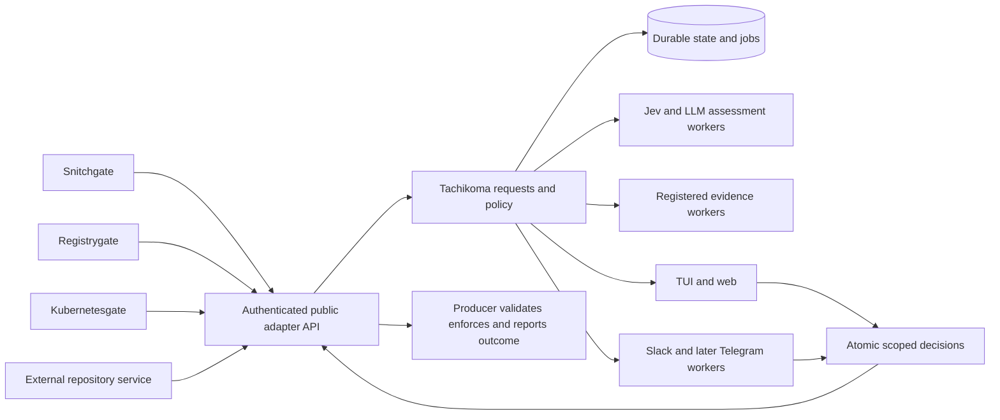

# Tachikoma monorepo and adapter implementation plan

Status: proposed implementation plan, updated 23 October 2026. Tachikoma becomes
an approval control plane with independently built service adapters. The first
working integration is Snitchgate; Registrygate follows with Cargo, npm and Go,
then Python. Kubernetes moves into its own service boundary. Services developed
in other repositories use the same public API as services in this monorepo.

This replaces the earlier three-repository architecture proposal. Repository
consolidation does not combine service privileges, databases or deployments.
The existing live Snitchgate installation remains authoritative throughout
migration until an explicit cutover has passed the release gates below.

## Architecture decisions

1. Use `noeljackson/tachikoma` as the monorepo, preserving Git history and the
   service names `snitchgate`, `registrygate` and `kubernetesgate`.
2. Each service owns its domain logic and enforcement. Tachikoma owns requests,
   policy evaluation, shared AI coordination, human review and decision history.
3. Use a versioned wire contract for all service integration. Optional client
   libraries share protocol code only; domain implementations remain private.
4. Start with one Tachikoma daemon and a local SQLite database. Durable jobs,
   transactional events and bounded workers provide recovery without requiring
   an external message broker.
5. Start live integrations in manual mode, with classification displayed.
   Automatic authority requires explicit deterministic policy and later
   validation. Model confidence alone never grants an action.
6. Keep each producer's deadline, local constraints and unavailable behavior
   independent of Tachikoma. Central failure cannot extend a pending operation.
7. Use a common review model across TUI, web and Slack. Telegram follows after
   that transport contract is proven.



### Ownership

| Component | Owns | Credentials and authority |
| --- | --- | --- |
| Tachikoma | Queue definitions, principals, policy, requests, AI scheduling, investigations, decisions, audit | Approval administration and control-plane storage |
| Snitchgate | OpenSnitch connection, process/network facts, temporary rules, packet deadlines, local fallback | Its OpenSnitch connection and narrowly scoped network authority |
| Registrygate | Native registry protocols, package identity, quarantine, artifact integrity, package evidence, caching, byte release | Registry credentials, approved upstream fetches, artifact storage |
| Kubernetesgate | Cluster observations, resource identity, Kubernetes evidence, scoped execution when implemented | Its own kubeconfig or workload identity and restricted RBAC |
| Assessment worker | Approved Jev/model tasks, bounded outputs, provider usage | Only its assigned model credentials and provider egress |
| Evidence worker | A registered evidence operation and its provenance | Only the data sources and resources assigned to that operation |
| Review transport worker | Message delivery and authenticated reply normalization | Its Slack or Telegram credentials and narrow review permissions |
| TUI and web | Queue navigation, evidence, assessment, investigation and review forms | Authenticated reviewer session and permitted queues |

Raw registry secrets, cluster credentials and the OpenSnitch connection stay
with their owning services. Tachikoma does not gain those credentials to
perform investigations. A producer-reported outcome is an audit statement,
not independent proof of a kernel change, package installation or cluster state.

## Current implementation and migration constraints

The prototype has SQLite proposals, idempotency keys, Connect/gRPC services,
a loopback web UI, a Ratatui client and durable investigation transcripts.
The queue UI work in [PR 4](https://github.com/noeljackson/tachikoma/pull/4)
adds adapter filters, counts, previews and refresh. The dependency fixes are in
[PR 3](https://github.com/noeljackson/tachikoma/pull/3). These changes do not
implement the service decision protocol described here.

The important gaps are concrete:

- `src/analysis.rs` delivers jobs through an in-memory Tokio channel; startup
  recovery marks unfinished analyses failed. It needs persistent job ownership,
  deadlines and retry state.
- `src/store.rs::transition` checks the proposal state without enforcing its
  expiry. Existing approvals cannot become live grants under the new API.
- `src/opensnitch.rs` and the poller in `src/main.rs` read the OpenSnitch GUI
  history database. That ingestion belongs in Snitchgate and is distinct from
  handling a live pending connection.
- `src/kubernetes.rs` and `suggest-kubectl` create command observations only.
  They do not load cluster credentials or execute Kubernetes changes.
- `src/ai.rs` contains local CLI provider authentication and program execution.
  Domain evidence operations move to their owning workers. Workstation CLI
  providers become optional isolated workers.
- `src/config.rs` and `StatusApi` contain hardcoded adapter settings and names.
  Registration and capability reporting replace those dependencies.
- Profile analyses and conversational investigations use overlapping execution
  machinery. They should share durable scheduling, cancellation, budgets and
  provider interfaces, while retaining distinct user-facing purposes.

Snitchgate already supplies valuable behavior: bounded pending admission,
independent timeouts, audit-before-permit, Jev/Ollama assessment, temporary
allow/deny scopes, an isolated TUI, and authorized Slack reply handling with
persistent delivery records. Port those semantics and their failure tests.
Do not replace them with a simpler approval record.

Registrygate currently contains design documents rather than registry service
code. Its protocol implementations are new work. Kubernetesgate initially
extracts the existing observation adapter; real cluster execution is a later
capability with a separate release gate.

## Repository and dependency boundaries

Use a Cargo workspace for Rust packages and a shared lockfile, while releasing
and deploying service binaries independently. Cargo workspaces share a lockfile
and build directory; that is dependency coordination, not permission for
services to import one another's internals.
[Cargo workspace behavior](https://doc.rust-lang.org/cargo/reference/workspaces.html).

```text
Cargo.toml
Cargo.lock
protocol/
  tachikoma/approval/v1/       versioned API definitions
  schemas/                   generic manifest and evidence envelope schemas
  fixtures/                  compatibility request and response fixtures
crates/
  approval-protocol/         generated wire types only
  approval-client/           optional transport retries and protocol helpers
  control-plane/             Tachikoma request lifecycle and policy
  control-store/             Tachikoma persistence migrations and job leases
  assessment/                shared assessment interfaces and validation
services/
  tachikoma/                 daemon composition and authenticated API
  snitchgate/                private network implementation and OpenSnitch proto
  registrygate/              private package gateway implementation
  kubernetesgate/            private Kubernetes implementation
apps/
  cli/                       tachikoma CLI
  tui/                       generic Ratatui review client
  web/                       generic web review frontend
workers/
  assessment/                Jev and approved LLM provider execution
  review-slack/              Slack transport
  review-telegram/           later Telegram transport
  provider-cli/              optional workstation CLI providers
examples/
  external-adapter/           standalone non-Rust reference integration
conformance/
  adapter/                   public protocol and failure behavior suite
contrib/
  systemd/                   portable service unit templates
  compose/                   isolated development and integration stacks
docs/
  queue-control-plane.md     this plan
  adapter-guide.md            public integration guide when implemented
```

This is the target layout. Introduce packages as responsibilities are extracted;
creating every empty crate is not the first implementation milestone. Domain
schemas stay in the relevant service directory and are registered as versioned
artifacts. The public protocol contains generic envelopes, not Rust enums for
all supported registries, clusters or firewalls.

Enforce these rules from `cargo metadata` in CI:

- `control-plane`, `control-store` and client applications cannot depend on any
  `services/snitchgate`, `services/registrygate` or `services/kubernetesgate`
  implementation package.
- A producer may depend on `approval-client` or `approval-protocol`, but cannot
  depend on Tachikoma's store, AI, policy implementation or another producer.
- The protocol package has no database, model, chat, process-execution or domain
  dependencies. The client package does not read application credentials from
  unrelated locations.
- Domain helper crates remain inside their owning service boundary. There is
  no general `shared` crate into which domain code gradually accumulates.
- Applications and workers access control-plane state through authenticated
  APIs. They do not open another process's SQLite database.

Use Rust 1.96 as the initial workspace floor, matching Tachikoma's current
Docker build. Verify the declared floor and the workstation compiler in CI.
Resolve the existing `rusqlite` 0.37/0.38 divergence before importing Snitchgate
into the workspace. Cargo restricts duplicate native `links` dependencies, so
both services need a compatible SQLite dependency graph and explicit feature
review. Preserve the OpenSnitch vendored protocol's provenance and license;
its tonic/prost stack need not be rewritten to match Tachikoma's wire generator.
[Cargo native link constraints](https://doc.rust-lang.org/cargo/reference/resolver.html#links).

## Services queues and adapter registration

A service kind describes an integration; a service instance is an authenticated
running producer; a queue is a configured review workflow. Keep those identities
separate. Multiple workstations or clusters can use the same service kind
without sharing request ownership or credentials.

| Logical queue | Initial service | Subject and decision |
| --- | --- | --- |
| `network.egress` | Snitchgate | Exact pending network request; deny once or bounded temporary allow |
| `packages.cargo` | Registrygate | Exact crate artifact and verified byte digest |
| `packages.npm` | Registrygate | Exact scoped package/version/tarball and verified byte digest |
| `packages.go` | Registrygate | Exact module/version/ZIP and integrity evidence |
| `packages.python` | Registrygate later | Exact wheel or source distribution variant and digest |
| `kubernetes.observe` | Kubernetesgate | Read-only observation and investigation |
| `kubernetes.change` | Kubernetesgate later | Exact typed operation, target and manifest digest |
| Administrator-approved custom queue | External service | Registered subject schema and actions |

A queue's effective identity includes the deployment realm and producer
permissions, not just its display name. A queue definition selects subject
schemas, allowed actions and scopes, mode, reviewer roles, evidence requirements,
model budget, data-export policy, routing, admission limits and deadline caps.

The UI groups by service, then queue, with an All view. Additional filters cover
instance, state, priority, risk, requester and text. Queue counts distinguish
pending requests from settled history. Filtering never grants access to an
otherwise unauthorized queue.

### Registration lifecycle

An administrator enrolls a service principal and approves its manifest. The
running service authenticates as that principal and advertises its supported
manifest version, build version, capabilities and health. A producer cannot
register itself into another queue or grant itself review permissions.

A manifest declares service kind/version, subject schema IDs and digests,
queue suggestions, actions, bounded scope parameters, evidence sections,
optional evidence operations and plain-text display descriptors. The
administrator controls the actual queues, permissions, policies, routing and
allowed export destinations.

Manifests cannot contain executable UI code, shell commands, arbitrary fetch
URLs or unrestricted template engines. Version one renders generic text,
key/value sections, tables, code previews and constrained choice forms. New
schema or capability versions require explicit compatibility validation;
registration is not an automatic policy upgrade.

The current `opensnitch` adapter label maps to service kind `snitchgate` and
queue `network.egress` during migration. Preserve old identifiers in historical
records. A compatibility mapping translates display/query names without
rewriting historical subjects or giving old records new authority.

## Public adapter API

Add `tachikoma.approval.v1` beside the prototype proposal API. Reuse the existing
Connect approach, with generated protobuf contracts and a documented JSON
mapping. Simple clients can use unary HTTP JSON calls; generated clients may
use protobuf. Start with unary calls and bounded long polling, then add a
resumable server stream as an optimization. This avoids requiring streaming
support for a service developed in another repository.
[Connect unary JSON support](https://connectrpc.com/docs/curl-and-other-clients/),
[Connect protocol](https://connectrpc.com/docs/protocol/).

| Operation | Authorized caller | Required behavior |
| --- | --- | --- |
| Enroll or update registration | Administrator | Validate manifest, establish principal and queue permissions |
| Advertise capabilities and heartbeat | Enrolled service | Report supported approved versions and health without changing policy |
| Submit request | Producer | Persist request, immutable fingerprints, jobs and audit before acknowledging |
| Get request or list own requests | Producer | Return only that principal's authorized records |
| Poll events | Producer or authorized reviewer | Ordered cursor, bounded wait, bounded page size, explicit resync on a retention gap |
| Cancel request | Owning producer | Idempotent transition; cancellation cannot revive an operation |
| Decide request | Authorized reviewer or policy engine | Atomically validate identity, revision, scope, mode and expiry |
| Report enforcement outcome | Owning producer | Idempotent receipt for the exact request and decision |
| Claim or complete work | Assigned worker role | Lease, budget, capability and fencing checks |

Transport identity supplies the producer identity. A `service` field in a body
is descriptive and cannot select the authenticated principal. Local deployment
uses private Unix sockets plus peer identity and per-service credentials when
multiple services share an OS user. Peer UID alone cannot distinguish two
processes running as Noel. Remote deployment uses authenticated TLS with
individually enrolled service identities. Reviewer and worker credentials have
separate roles and permissions.

No callback URL is accepted from a request. Producers initiate outbound watches
or polls, and evidence workers claim explicitly authorized jobs. This keeps a
new service from turning Tachikoma into an arbitrary HTTP client.

### Request and decision binding

A request includes these immutable inputs:

- Protocol and subject-schema version, queue and producer-local request ID.
- A producer-generated nonce and idempotency key scoped to the authenticated
  principal, instance and queue.
- The action requested, exact subject, candidate use scopes and typed
  preconditions. The server intersects these with administrator policy.
- A bounded evidence snapshot with provenance, outcomes and timestamps.
- Original creation/deadline information and the requested operating mode.

The server creates an internal request ID, effective deadline, canonical
subject/evidence digests and policy/manifest revisions. Define canonical
serialization in phase 1, including duplicate-key rejection, numeric rules,
Unicode handling and explicit schema-version inclusion. Hashes never substitute
for schema validation.

Repeated submission with the same idempotency key and immutable fingerprint
returns the same request, including its expired or settled state. Reuse with a
different subject, action, evidence or deadline is a conflict. A retry cannot
renew an old request. New evidence that matters to consent creates a new
revision and invalidates the earlier review context.

The submission fingerprint stays stable when server-side evidence workers add
results. The server assembles a versioned evidence snapshot for review and
binds the decision to that snapshot. Material evidence changes increment the
review revision and invalidate stale cards; subject or action changes require
a new request. The producer can retrieve the bound snapshot through its
authorized request view rather than trusting a digest supplied by a third party.

A decision binds the request ID, producer principal/instance, queue, producer
nonce, request revision, subject/evidence digests, action, exact scope,
preconditions, policy revision, decision ID, actor, issue time and validity
limit. The producer checks those bindings against the operation that is still
pending locally before acting. Decision expiry is bounded by the original
request and local operation deadline.

Use authenticated online decision delivery initially. Offline signed grants,
reusable authority and disconnected caching are later capabilities requiring a
separate trust-key, consumption and revocation design. Admission caching and
artifact content caching do not imply authorization caching.

The scope schema is domain-specific but reviewable through generic forms. An
OpenSnitch five-minute temporary rule must show its effective process and
destination match. A package grant binds an exact digest and allowed delivery
scope. Kubernetes change approval binds cluster identity, namespace, operation,
manifest digest and required resource preconditions. An arbitrary process
command or model-generated operator is not a scope.

### External repository integration

Publish the protocol artifact independently of daemon releases, together with
an optional small Rust client. External producers may generate their own client
or use HTTP JSON directly. They do not need the workspace, service source trees,
Rust, shared databases or Tachikoma's model libraries.

A standalone example in another language must prove enrollment, submission,
restart/reconnect, human decision, local enforcement simulation, outcome
reporting and timeout fallback. Build its Docker test context without parent
workspace files or path dependencies. Later mirror it to a separate reference
repository; the initial conformance test must already simulate that boundary.

Define major API compatibility and capability negotiation. During the first
public release, test the current and previous supported minor client against
the server. Additive fields keep defaults; unknown enum actions and unsupported
subject versions cannot become permissive defaults. Breaking behavior needs a
new API or subject-schema major version with a migration guide.

## Request lifecycle and durable work

Keep review state, decision validity, job delivery, notification delivery and
producer outcomes separate. A request that is allowed is not necessarily
executed, and an expired grant does not erase a previously recorded decision.

```text
Request review
accepted -> assessing -> awaiting_review -> allowed | denied
accepted or assessing -> allowed | denied under explicit policy
any nonterminal state -> expired | cancelled

Worker job
ready -> leased -> completed
               -> retry_wait -> ready
               -> failed
unfinished job -> expired | cancelled

Producer outcome
not_reported -> enforced | not_enforced | unknown
```

Persist state and audit in one transaction. Approval, cancellation and expiry
compete through compare-and-swap on the current request revision and state.
The first valid transition wins. All paths, including policy automation, check
expiry and authority inside that transaction; a background expiry sweep alone
is insufficient.

An approval racing with producer cancellation cannot force local execution.
The producer independently checks that its operation remains pending and that
its monotonic local deadline has not passed. If it already timed out, it ignores
an allow and reports the local outcome. Absolute server time is not allowed to
extend a producer deadline under clock skew.

Use persistent jobs with lease tokens, expiry, attempt counts and fencing
versions. A stale worker cannot commit after a replacement claim. Retry only
transient failures within the request deadline and attempt budget. Human
approvals are immutable decisions, not worker operations to retry blindly.

Write an event/outbox record in the same transaction as each externally visible
state change. Delivery is at least once; consumers deduplicate by event and
decision IDs. Cursor retention gaps trigger an authorized snapshot resync.
There is no promise of exactly-once effects across a network.

A producer persists its own decision-consumption and outcome state before
acknowledging execution. After a crash, reconcile against the real local
operation where possible. An uncertain result remains `unknown`; it cannot
trigger a second Kubernetes apply or reopen a timed-out firewall request.

### Storage and scheduling

Initial control-plane records are principals, approved manifests, queue
revisions, requests, immutable revisions, evidence snapshots, assessments,
review decisions, jobs and leases, transport deliveries, producer receipts and
audit events. The daemon is the only owner of this database. Workers use APIs.

Use SQLite WAL on a local filesystem, short bounded write transactions, a busy
policy, checkpoint monitoring and consistent backups. WAL permits concurrent
readers but retains one writer; network filesystems and multi-host access are
outside this deployment model. Move to a server database only after measured
contention or availability requirements justify it.
[SQLite WAL constraints](https://www.sqlite.org/wal.html).

Use one canonical durable event journal for the new investigation engine.
SQLite commits event metadata; bounded large payloads may be immutable blobs
referenced by digest. Keep JSONL as an export/interchange format. Preserve
existing canonical JSONL transcripts unchanged and import them idempotently
through an explicit legacy reader before retiring the old runner. Test recovery
between blob creation, event commit and export; orphan cleanup must not delete
referenced evidence.

Reserve admission and assessment capacity for the network queue. Apply
per-principal and per-queue pending limits, worker concurrency, evidence/model
budgets, storage caps and human-message rate limits. Use deadline-aware work
selection within those limits and fairness between queues. A package installation
must not exhaust all capacity needed for a short firewall review.

Initial synthetic targets are admission and decision-commit p95 below 100 ms
on the workstation under a bounded mixed-load fixture. These are engineering
acceptance targets to measure, not current benchmark results. Test notification
and decision-delivery latency separately from human and model time. No timing
target permits extending a producer's original deadline.

## Policy classification and investigations

The processing order is schema/authentication checks, deterministic constraints,
required evidence validation, optional assessment, then policy or human review.
Producer-supplied risk labels and model recommendations are advisory inputs.
Administrator policy decides which actions can receive authority.

Support three explicit queue modes:

| Mode | Behavior |
| --- | --- |
| Shadow | Collect assessments and simulated decisions; the existing owner still decides the live operation |
| Manual | Display assessment and require an authorized human for every grant |
| Policy | Apply explicit approved rules; escalate other eligible requests to a human |

Mode is administrator-controlled and captured in the request revision. No
producer flag can lower an enforced queue into shadow or policy-auto-allow.
Shadow outputs are visibly non-authoritative and cannot reach an enforcer as
live grants. Retried shadow records are never converted into manual grants.

Port Jev and the local Qwen integration behind a common bounded assessment
interface. Keep provider IDs and model versions configurable; record the exact
model, prompt/schema revision, evidence digest, latency and usage. Separate a
fast classification task from an interactive investigation with a larger budget.
Both use the same durable job, cancellation and audit machinery.

Assessment results distinguish classification, recommended action, rationale,
confidence and evidence gaps. Jev and LLM disagreement remains visible. Do not
average their scores into invented certainty. Any automation threshold needs
per-domain evaluation fixtures, measured errors and deterministic constraints;
self-reported model confidence is not a calibrated probability.

In the initial manual deployment, unavailable or timed-out classification does
not hide a request from the human inbox. Required integrity or evidence failures
remain hard blocks where queue policy requires them. A provider outcome is
`complete`, `partial`, `unavailable`, `unsupported` or `not_requested`; an
unavailable advisory lookup is not a clean bill of health.

Registrygate owns package identity, native integrity interpretation, archive
facts and package-specific vulnerability lookups, either locally or through a
registered package evidence worker. Tachikoma schedules permitted work and
checks provenance/freshness policy. This updates the earlier Registrygate
proposal that placed advisory lookup implementation directly in the approver.
Models explain supplied facts rather than invent CVE results.

Investigations can request registered read-only evidence operations through
bounded worker capabilities. Domain workers choose approved operations and
validate arguments; they do not accept model-generated shell commands or fetch
URLs. Draft remediation becomes a new linked request with fresh consent.
Investigating or approving the parent never authorizes that draft implicitly.

Treat package descriptions, process names, repository files and evidence text
as untrusted model input. Enforce redaction and output schemas, separate system
instructions from evidence, and keep secrets/raw environment/HTTP credentials
out of model payloads and logs. Queue policy controls whether private package
names or other metadata may leave the machine for hosted models or advisories.
Local model execution is the default starting point for private facts.

## Review interfaces and transport parity

The same authorized review API serves TUI, web and human transport workers.
Tachikoma's UI renders approved manifest descriptors, with a complete generic
evidence fallback for external adapters. No domain implementation crate is
linked into the generic UI.

| Capability | Target behavior |
| --- | --- |
| Service and queue navigation | All view, nested service/queue filters, instance filter, pending/history counts |
| Pending inbox | Deadline and age, action, subject summary, risk, assessment state and confidence |
| Request details | Evidence and provenance, Jev/LLM rationale, gaps, requested scope, policy reasons |
| Actions | Manifest-declared approved actions and constrained scope choices with visible consequences |
| History | Who decided, when, source transport, scope, request revision and producer-reported outcome |
| Health | Producer heartbeat and actual upstream status, worker/model status, transport readiness, queue saturation |
| Search | Text plus state, requester, instance, service, queue and risk filters |
| Investigations | Model choice, transcript, bounded tools, cancellation, draft remediation |
| Failure behavior | Reconnect/resync, stale indicators and disabled decision controls until current authority is known |
| Terminal usability | Stable selection, scrolling, keyboard help, safe text rendering, terminal restoration and small-screen layout |

Carry over Snitchgate's pending/history/health separation, classification detail,
deadline countdown, temporary scope selection, search and disconnected behavior.
Use generic approve/reject interaction only where those actions match the
adapter's semantics; show an exact scope summary before committing authority.
No durable permanent firewall permission is offered by a generic Allow button.

The service authenticates and authorizes the actor on each decision. Reviewer
identity never comes from an adapter-supplied field or arbitrary transport text.
An authenticated transport worker may assert identities only in its approved
transport realm; the server maps those identities to reviewer roles and checks
queue authorization. A Slack worker cannot impersonate an administrator or
assert actors from another transport.
Bind Slack replies to workspace, approved channel/thread/message, actor,
request/revision and nonce. First valid terminal decision wins across Slack,
TUI and web; settle other cards without creating another decision. Batch review
covers an immutable displayed member set, never future arrivals.

Preserve Slack's configured-channel behavior and actor allowlist during the
initial migration. Port its durable route and delivery mapping. Reconcile
ambiguous posting outcomes rather than issuing unlimited duplicate prompts.
A transport receipt is distinct from a human decision and from enforcement.
Telegram later implements the same review transport contract and authorization
checks, with no second approval database.

## Service integration details

### Snitchgate

Keep the working OpenSnitch broker and its local audit-before-permit behavior.
Add an explicit backend setting for local versus Tachikoma review. Capture that
choice for each pending request; a backend outage does not silently select a
more permissive reviewer or revive an expired request.

Move historical connection import and network proposal construction into
Snitchgate. Live requests carry captured process/user/protocol/destination facts,
resource hints and the local deadline. Avoid treating a host name as a verified
HTTP file path: only attach package/URL detail when a suitable source actually
observed it. OpenSnitch connection metadata cannot supply arbitrary encrypted
HTTP payload contents.

The central backend submits the request, waits under the local deadline,
validates the returned scope and records local consumption/outcome before
reporting success. Timeout/unavailability preserves the configured local deny
once behavior. A temporary rule's duration and match are explicit capabilities;
Tachikoma cannot generate rule operators or permanent policy.

During shadow testing, the existing local/Slack path remains the sole live
decision authority. Central review is recorded without sending authoritative
prompts or duplicate enforcement replies. At cutover, switch review authority
for new requests and drain old pending requests under their original owner.
Keep one OpenSnitch UI connection owner. The existing workstation handover
restores the native GUI on broker failure; central readiness must reflect the
configured review path, not merely an open daemon port.

After parity, the central TUI becomes the default multi-service review screen.
Retain the standalone Snitchgate UI/local backend for diagnostics and rollback
during migration. Do not automatically run a native GUI decision path alongside
Slack for the same live OpenSnitch request.

### Registrygate

Keep Registrygate independently runnable with an explicit local-rules backend
and optional remote Tachikoma backend. A failed remote approver never selects
local allow automatically. Each upstream registry credential and fetch permit
stays local to the gateway.

Implement the common release path once within Registrygate: resolve immutable
identity, fetch into bounded quarantine, verify available native integrity,
compute a byte digest, gather package evidence, obtain approval, then serve the
already-verified bytes. A cache hit still needs current authorization. Never
approve a mutable coordinate and refetch different bytes afterward.

Deliver protocol support as separate milestones: Cargo sparse index and crate
artifacts; npm scoped metadata and tarballs; Go module proxy and checksum
behavior; then Python Simple API and wheel/source variants. Preserve native
verification and denial semantics. Integration tests must check stock clients,
locked/custom upstream URLs, alternative/direct fallback, private scopes and
bypass configuration before claiming enforcement coverage.

Registrygate's internal protocol adapters may share its artifact coordinator,
quarantine and content store. That code stays inside Registrygate's boundary;
it is not shared with the network or Kubernetes service.

### Kubernetesgate

Extract command observation, namespace/context identity, domain risk annotation
and Kubernetes evidence from Tachikoma. Begin as a read-only producer. Move the
specialized CLI command into its service CLI while retaining a temporary
forwarding/deprecation path for `tachikoma suggest-kubectl`.

Real execution follows only after the generic decision/outcome contract works.
Use typed operations and restricted RBAC, with server-side validation/dry-run
where appropriate. Approval binds the target cluster identity, namespace,
operation, manifest digest and required current resource versions. A changed
resource or manifest invalidates the approval instead of broadening it. Secret
objects and credentials are excluded from model evidence. Never turn arbitrary
model-generated `kubectl` text into an execution capability.

## Deployment credentials and operations

Run service adapters, assessment providers and transport workers as independently
supervised processes. Each has its own health, restart behavior, credentials,
resource limits and narrow egress. Give public adapters the same integration
path as built-in services; avoid an undocumented privileged in-process path.

Use private local sockets by default. Expose a remote API only with authenticated
TLS and explicit listener configuration. Browser review retains CSRF/origin
checks and an authenticated reviewer session when exposed beyond a private
local deployment. Service credentials cannot approve or administer policy.

On Noel's workstation, Noelarchy remains the source of truth for installed
systemd units, root-owned deployment configuration, bootstrap OpenSnitch policy
and OpenBao credential provisioning. The monorepo contains generic templates
and documented credential names, never Bao tokens or machine-specific secret
loading scripts. Deliver separate systemd credentials to Jev, Slack and each
service; no child inherits the full workstation secret environment.

Keep bootstrap egress independent of the request being reviewed. DNS, the
configured model/Jev endpoints, Slack and approved registry acquisition paths
must have narrow deliberate connectivity so the approver never waits for its
own approval. Preserve the existing working workstation policy until a staged
replacement is validated.

Provide queue health, deadline/expiry counts, model latency, worker retry and
lease metrics, notification delay, stale/duplicate decisions, producer outcomes
and disk/checkpoint pressure. Log request/decision IDs and redacted reasons;
avoid raw provider bodies and credentials. Set retention independently for
request metadata, evidence blobs and model transcripts, preserving configured
audit obligations. Test backup/restore and retention/cursor-resync together.

## Implementation phases and acceptance gates

Each phase should land as reviewable PRs. Protocol and persistence changes land
before live routing. Documentation alone does not switch services, archive
repositories, change registry clients or deploy workstation policy.

| Phase | Deliverable | Acceptance gate |
| --- | --- | --- |
| 0 Baseline | Resolve pending fixes/UI PRs through normal review, record source/deployment versions, snapshot databases, pin dependencies and toolchain | Reproducible baseline, supply-chain gates and rollback artifacts; current services continue working |
| 1 Workspace and boundaries | Import service source/history/licenses, align SQLite dependency graph, extract wire/client and core packages, boundary CI | Each service builds independently; forbidden dependency tests fail; standalone behavior preserved |
| 2 Public contract and fake producer | Versioned API, approved manifests, principals, queue definitions, request/decision binding, expiry and cancellation | Separate-context non-Rust producer passes auth, idempotency, timeout, conflicting decision and replay tests |
| 3 Durable execution and manual review | SQLite jobs/leases/outbox, shared assessment interface, Jev/Qwen workers, TUI/web actions and Slack transport | Restart/crash recovery, stale-worker fencing, manual-first behavior, transport race tests and mixed queue fairness pass |
| 4 Snitchgate bridge | External backend, network schema/scopes, outcome receipt, shadow comparison, isolated OpenSnitch fixtures | No late/replayed/broadened allow; audit failure denies safely; original deadline/fallback and one-owner behavior preserved |
| 5 First live vertical slice | Opt-in manual Snitchgate requests with classification in central TUI/Slack | Sustained trial with forced daemon/worker/transport outages, clean rollback and correlated audit/receipts |
| 6 Registrygate | Common artifact pipeline, then Cargo, npm, Go; Python follows | Stock-client protocol/integrity/bypass tests, exact-byte grant binding, outage quarantine and queue isolation |
| 7 Kubernetes extraction | Independent read-only observation producer, then separately reviewed typed execution | No credentials in Tachikoma; manifest/resource mismatch rejection; restricted RBAC and outcome reconciliation |
| 8 Public integration release | Adapter guide, protocol artifacts, minimal SDK, conformance suite, standalone example and supported version matrix | External service works without workspace internals; upgrade/backward-compatibility tests pass |
| 9 Legacy retirement | Remove embedded domain imports, duplicate runners and obsolete routing after parity | Historical data still readable; live services have supported rollback and independent releases |

The external adapter example begins in phase 2; phase 8 packages and documents
that proven interface. Kubernetes observation extraction can proceed after the
contract stabilizes, but real cluster changes do not take priority over the
network and package paths.

### First implementation PRs

1. Add a repository boundary map, workspace skeleton and repeatable build/test
   commands. Preserve existing binary names, units, data paths and source history.
2. Introduce the new protocol/schema package and a fake producer/enforcer with
   a private test socket. Keep current proposal APIs available as legacy views.
3. Implement authenticated request admission, immutable fingerprint/idempotency,
   effective deadlines and atomic terminal decisions with explicit expiry checks.
4. Implement event polling and enforcement receipts, then prove the complete
   fake-producer request/review/decision/receipt path after restart.
5. Add persistent jobs, lease fencing and outbox delivery before attaching real
   model or transport workers.
6. Add the Snitchgate backend and classification/manual-review parity using
   isolated OpenSnitch and Slack fixtures; promote only after the failure suite.

This order produces a small working approval path before reorganizing every
feature or building all registry protocols.

## Test and release matrix

Use isolated Docker application tests, fixture sockets, fake clocks, mock
providers and test transports. Never attach an integration test to the live
OpenSnitch socket or send real Slack messages as a test without task-specific
authorization. Keep the current source supply-chain workflow and preserve scan
history. Native format/Clippy/build checks supplement runtime tests in Docker.

| Area | Required tests |
| --- | --- |
| Dependency boundaries | Core cannot import domains; producer cannot import core store/AI; protocol/client graph remains minimal |
| API and identity | Cross-principal access, unauthorized queue/action, same-UID service separation, malformed/oversized evidence, unsupported version, idempotency conflict |
| Decisions | Expiry at transaction time, duplicate approve, simultaneous approve/deny, stale revision, wrong nonce/digest/realm/scope, actor role changes |
| Cancellation | Cancel before/after assessment, producer timeout racing approval, disconnected producer, already-consumed decision |
| Work recovery | Crash after admission, lease claim, external send, decision commit or local enforcement; stale lease completion; retry exhaustion |
| Evidence and AI | Jev/LLM disagreement, invalid output, injection attempts, unavailable evidence, private-data export, redaction, cancellation and bounded concurrency |
| Review transports | Wrong workspace/channel/thread/user, duplicate event, stale card, ambiguous delivery, Slack/TUI race and restart without repost storms |
| UI | Service/queue and state counts, search, exact selected ID under refresh, history, health, deadline, scope form, disconnected controls and terminal cleanup |
| Snitchgate | Once/five-minute scope, timeout deny, audit failure, daemon disconnect, no permanent policy, no duplicate native-GUI/central ownership |
| Registrygate | Exact downloaded bytes, integrity mismatch, changed coordinates, unapproved cache hit, client fallback/bypass, partial transfer and central outage |
| Kubernetesgate | Observation-only mode, restricted target, manifest/resource mismatch, RBAC denial, uncertain execution result without blind replay |
| Operations | Disk full, restore, transcript/blob consistency, queue starvation, bootstrap dependency, credential isolation and independent service restart |

Source scans cover the complete workspace lockfile and service-specific
manifests/vendored protocol provenance. Path-scoped build jobs are useful,
but shared lockfile, protocol or toolchain changes trigger all affected
compatibility and service gates. CI also tests each daemon with only its own
runtime image/configuration and an intentionally absent Tachikoma where a local
backend is supported.

Release independently versioned binaries/images with a common source commit
and supported protocol range. Publish the SDK/protocol artifacts independently;
changing a service's implementation does not require all external adapters to
upgrade. Include build provenance and the same supply-chain checks used locally.

## Source migration and rollback

Import Snitchgate with recorded source commits, its tests, protocol licenses and
existing standalone mode. Import Registrygate's design and reconcile its older
repository/lookup ownership wording with this plan before implementing it.
Keep the original repositories readable until independent monorepo builds,
releases, documentation and links are validated. Redirect or archive them only
as a separate explicit repository-maintenance action; avoid two writable sources
of truth for long-term service development.

Keep old proposal and transcript data readable. A legacy record is historical
or investigation-only under the new API and cannot be converted into a live
allow. Use versioned forward migrations, consistent backups and tested restore;
retain old databases until new readers and audit export are validated.

At a live cutover, identify the sole decision owner, stop new admission to the
old path, drain or expire its pending requests, and enable the new path for new
requests. Correlate old and new IDs without duplicating authority. Rollback
reverses routing for new requests and leaves settled decisions in their original
audit stores. Do not downgrade a database schema beneath a running process.

The first live success criterion is specific: a real Snitchgate request appears
in the correct central queue with classification and a visible deadline; an
authorized reviewer chooses an exact temporary action; Snitchgate validates and
enforces it once under the original deadline; the reported outcome appears in
history. Repeat with each component unavailable and demonstrate the expected
local fallback without a late permit. Registrygate and Kubernetesgate then
reuse that contract while retaining their own enforcement semantics.
