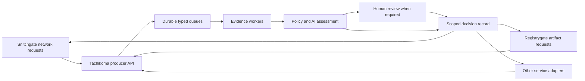

# Tachikoma queue based approval service

Status: proposed direction, based on the current Rust prototype. Tachikoma owns
durable review queues, evidence orchestration, deterministic risk policy, AI
assessment, human approval transports, and scoped decision delivery. Registrygate
and Snitchgate remain separate services and repositories that enforce decisions
at their own boundaries.

## Three repositories and service responsibilities

| Repository | Responsibility |
| --- | --- |
| `noeljackson/tachikoma` | Review contracts, queue definitions, workers, policy, Jev/Qwen integration, Slack/Telegram/web review, audit and producer SDK |
| `noeljackson/snitchgate` | OpenSnitch protocol, connection facts, network-specific TUI, packet-response deadlines and enforcement |
| `noeljackson/registrygate` | Cargo/npm/Go protocols, artifact acquisition, quarantine, integrity, immutable storage and download enforcement; Python follows |



Tachikoma returns authority for a specific request; it does not operate the
firewall, serve tarballs, run arbitrary shell commands, or hold deployment
credentials. A producer independently validates the returned subject, scope,
deadline and use conditions. A central allow cannot override the producer's
hard integrity, origin or resource constraints.

## Existing foundations and required changes

The prototype already has SQLite proposal records, unique idempotency keys,
expiry fields, review transitions, Connect/gRPC services, web/TUI views, and
advisory model investigations. These are useful foundations; replacing the
implementation does not require discarding the repository history.

The current `AnalysisScheduler` stores job descriptions in a bounded Tokio
channel. `recover_running_analyses` marks queued/running analyses failed at
restart. Durable leasing and retry must replace that delivery mechanism for
the proposed queues. The current `Store::transition` changes an awaiting-review
proposal by ID/state without enforcing its expiry. That must be fixed before
proposal approval becomes authority for a live producer. Producer identities,
queue ACLs, immutable subject digests and scoped decision receipts also need
explicit contracts. Existing approval records are not grandfathered into grants.

The prototype's generic action/risk strings and free-form evidence are not a
security boundary. Queue schemas, producer roles and server policy replace
caller-selected risk as the authority for decisions.

## Meaning of a queue

A queue is a configured review workflow, not a package registry implementation
or a message broker installation. It specifies a versioned subject schema,
allowed producers, evidence providers, policy, model budget, human routing,
deadline caps, retry limits, admission limits and scheduling class.

Initial logical queues:

| Queue | Producer | Subject | Scheduling |
| --- | --- | --- | --- |
| `network.egress` | Snitchgate | `network.connect.v1` | Short deadline with reserved admission/assessment capacity |
| `packages.cargo` | Registrygate | `artifact.download.v1` | Bounded artifact review |
| `packages.npm` | Registrygate | `artifact.download.v1` | Bounded artifact review |
| `packages.go` | Registrygate | `artifact.download.v1` | Bounded artifact review |
| `packages.python` later | Registrygate | `artifact.download.v1` | Bounded artifact review |
| Custom queues later | An explicitly registered service | Its registered schema | Its own budgets and allowed actions |

The three package queues share a subject contract and can share a policy
template while retaining separate limits and routing. An example custom
deployment queue would bind an exact environment, resource/plan digest and
operation. Approving it would return a decision to the deployment service;
Tachikoma would not run the deployment itself.

Illustrative future queue configuration, not accepted by the current daemon:

```json
{
  "queues": {
    "network.egress": {
      "subject_schema": "network.connect.v1",
      "producers": ["snitchgate"],
      "decision_mode": "manual",
      "deadline_cap_ms": 90000,
      "scheduling_class": "interactive",
      "assessment": ["jev", "qwen"],
      "review_routes": ["slack.firewall"]
    },
    "packages.cargo": {
      "subject_schema": "artifact.download.v1",
      "producers": ["registrygate"],
      "decision_mode": "manual",
      "scheduling_class": "artifact",
      "evidence": ["package_facts", "osv"],
      "assessment": ["jev", "qwen"],
      "review_routes": ["slack.packages"]
    }
  }
}
```

Effective deadlines are the minimum of producer, queue and policy deadlines.
The package deadline must fit the tested package client's timeout/retry behavior.
Queueing never extends the deadline of a held OpenSnitch RPC or HTTP transfer.
Missing model capacity leads to explicit unavailable assessment and manual
review, rather than blocking an urgent request behind a long artifact analysis.

## Extensible adapters

Keep three extension contracts separate:

1. **Service adapter or producer.** Runs with the service, validates its local
   subject, submits evidence, waits for a decision, cancels on local timeout,
   enforces the decision and reports its outcome. A Rust SDK is convenient;
   the wire contract remains usable from other languages.
2. **Subject and evidence adapter.** Registers a schema/normalizer, bounded
   evidence providers, allowed assessment tasks and a review renderer. The
   core still owns deadline checks, authorization, transitions and audit.
3. **Review transport adapter.** Slack, Telegram, web or TUI delivers the same
   review and normalizes authenticated responses. These are reusable across
   queues; each queue does not need its own bot implementation.

A service can define a new queue using an existing schema without writing a
new adapter. New subject kinds need a registered schema and capabilities.
Built-in subject adapters are compiled Rust initially. Custom network services
should use the producer API; they do not load arbitrary code into the daemon.
An external evidence-worker protocol can follow later with explicit grants,
budgets, credentials and output schemas. Model text cannot create tools,
upstream destinations, queue definitions or execution capabilities.

## Durable jobs and state machines

Start with a single-node SQLite WAL store and explicit transactional durability.
No external message broker is required for the first deployment. Separate
review state from worker delivery state and human-message delivery state.

```text
Review:
accepted -> assessing -> awaiting_review -> allowed | denied
                      -> policy_decided -> allowed | denied
Any nonterminal state -> expired | cancelled

Worker job:
ready -> leased -> completed
               -> retry_wait -> ready
               -> failed
Any unfinished job -> expired | cancelled
```

Persist admission and jobs before acknowledging submission. Claim jobs
atomically with a lease token, expiry and attempt count; stale workers cannot
commit results after their lease is replaced. Retry only transient failures,
within the original deadline and bounded attempts. Invalid requests fail
validation. Exhausted failures remain visible for investigation without
implicitly retrying human approvals.

Use deadline-aware scheduling within queue budgets and fair scheduling across
queues. Reserve capacity for network requests. Limit evidence/model concurrency
independently, and avoid making network review depend on an occupied GPU.
Queue saturation returns a bounded unavailable result; it must not silently
drop a request or permit the underlying action.

Core records are queue definitions, producer principals, reviews, immutable
subject/evidence snapshots, worker jobs/leases, human deliveries, decisions,
producer outcome receipts and audit events. A transactional outbox connects
state changes to chat posts and decision events. Delivery may be retried at
least once; correctness comes from idempotent transitions and replay checks,
not a claim of exactly-once network effects. Ambiguous chat posting outcomes
remain explicitly unverified rather than spawning unlimited duplicate cards.

## Producer API and decision contract

Keep API schemas and a lightweight SDK in this repository; no fourth shared
repository is needed. The SDK contains transport/data types, not model clients
or chat credentials. Add versioned services beside the prototype contract;
current proposal records must not be reinterpreted as live capabilities.

The logical operations are:

- Submit a review with queue/schema, immutable subject, evidence references,
  producer request ID, scoped idempotency key and deadline.
- Get/watch that producer's review and decision using bounded long-polling or
  a resumable event stream.
- Cancel a request whose local operation is no longer pending.
- Report an applied/not-applied/unknown outcome against the exact decision.

Producer identity and permitted queues come from transport authentication,
not a caller-supplied `producer` or `tenant` field. A local Unix socket uses
kernel peer credentials and roles; shared/remote use requires authenticated
TLS. Submission credentials cannot approve reviews, administer policy, inspect
another producer's reviews or choose an arbitrary callback URL.

An idempotency retry with the same subject returns the same review. Reusing
the key for different bytes, scope or evidence is a conflict. A decision binds:

- API/schema version, queue, producer and requester realm;
- original request ID and producer nonce;
- canonical subject digest and relevant evidence digest;
- policy/queue revision, action and explicit use scope;
- actor or deterministic-policy identity, issue time and expiry.

Network subjects bind captured process/user/protocol/destination and the live
request; artifact subjects bind registry, package/version, variant and verified
byte digest. Local enforcement checks every field against the pending action.
Expired, cancelled, mismatched, superseded and replayed decisions cannot apply.
Use transport-authenticated responses initially. Any future offline signed
grant needs an explicit trust-key, lease, expiry and revocation design.

Do not equate a producer receipt with independent proof of kernel enforcement
or completed installation. Receipts describe the producer's reported outcome.

## Policy AI and human review

Use deterministic transport/integrity constraints first, then bounded evidence
collection, optional Jev/Qwen assessment, and a human decision when policy
requires it. First integrations stay manual. Configured future automation
requires exact evaluated scope and evidence conditions; model confidence alone
does not grant an action.

Provider outcomes distinguish complete/partial/unavailable/not-requested.
Package vulnerability lookup is implemented code with source/freshness records;
models explain supplied findings instead of inventing advisories. Network and
artifact questions have separate schemas and prompts. Private names, raw
payloads, environment, headers and credentials are excluded from external model
and advisory queries unless an explicit data-sharing policy permits otherwise.

Human review checks actor authorization, queue, review/version, original
channel/thread or UI context, nonce, current subject and expiry in the same
decision transaction. First valid terminal decision wins across all transports;
other prompts are updated or invalidated. Late replies cannot revive a request.
Batch actions cover an immutable, displayed member set; late arrivals never
inherit a previous approval. Reusable grants require an explicit digest-bound
TTL/use scope and cannot be mislabeled as a one-shot approval.

Queue configuration is administrator-controlled and versioned. Tightening
policy invalidates affected pending/granted authority before further use.
Offline cached grants cannot promise immediate central revocation; the initial
design does not permit offline reuse by default.

## Boot failure and isolation behavior

Avoid a circular dependency where Tachikoma asks itself to permit its own
Slack, Jev, model, DNS or advisory connections. Deploy narrow bootstrap egress
independently before enabling producer routing. Artifact acquisition likewise
needs bounded Registrygate upstream egress before package approval is possible.

Snitchgate keeps its own packet deadline and current GUI fallback while a new
central integration is introduced. Registrygate keeps artifacts quarantined
when its configured approver is unavailable. Tachikoma cannot send a late allow
to override a producer that has already timed out.

Use distinct service credentials and producer roles. Registrygate keeps
upstream registry credentials; Tachikoma keeps model/chat credentials. Bound
payload size, evidence jobs, CPU, storage and human delivery rates per queue
and principal. Keep raw provider error bodies and secrets out of storage/logs.
An external worker never inherits unrelated control-plane credentials.

## Implementation sequence

1. Define typed subjects, authenticated producer roles and scoped decisions;
   enforce expiry in every terminal transition. Add a fake producer/enforcer.
2. Replace the in-memory analysis delivery queue with transactional jobs,
   leases, deadline-aware admission, retries, cancellation and outbox events.
3. Add queue definitions and a small subject/evidence adapter contract, with
   separate network and artifact queues. Validate recovery using fixture jobs.
4. Move the working Slack decision transport and Jev/Ollama assessment logic
   from Snitchgate into Tachikoma behind the new contracts. Keep tools advisory.
5. Integrate Registrygate and Snitchgate independently, using opt-in/shadow
   operation before live decisions. Preserve current working network services
   until the replacement has passed compatibility and failure tests.
6. Add Telegram and another small custom producer as extension-contract tests.
   Consider distributed workers or another database only after measuring need.

The repository may be substantially rewritten, but preserve Git history and
existing local data during development. No deployment, removal of the current
prototype, or replacement of the live Snitchgate approval service is implied
by this architecture proposal.
